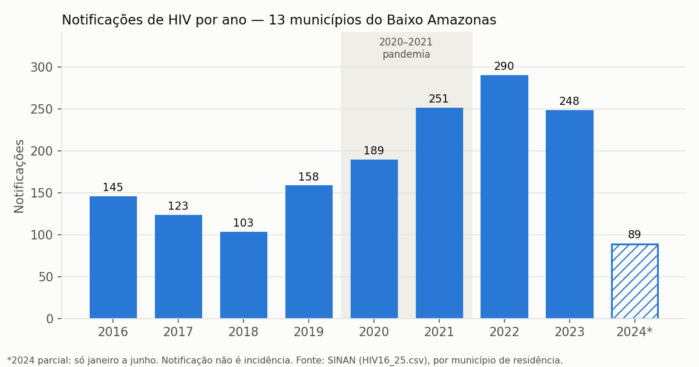
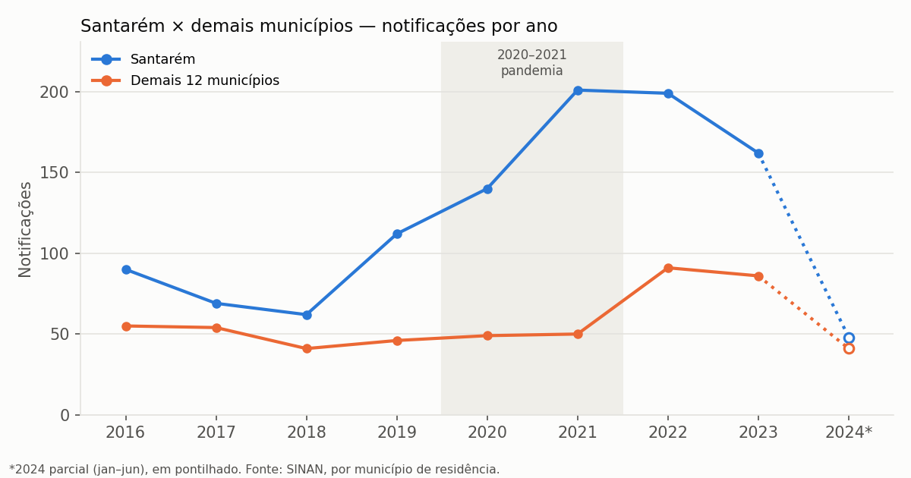
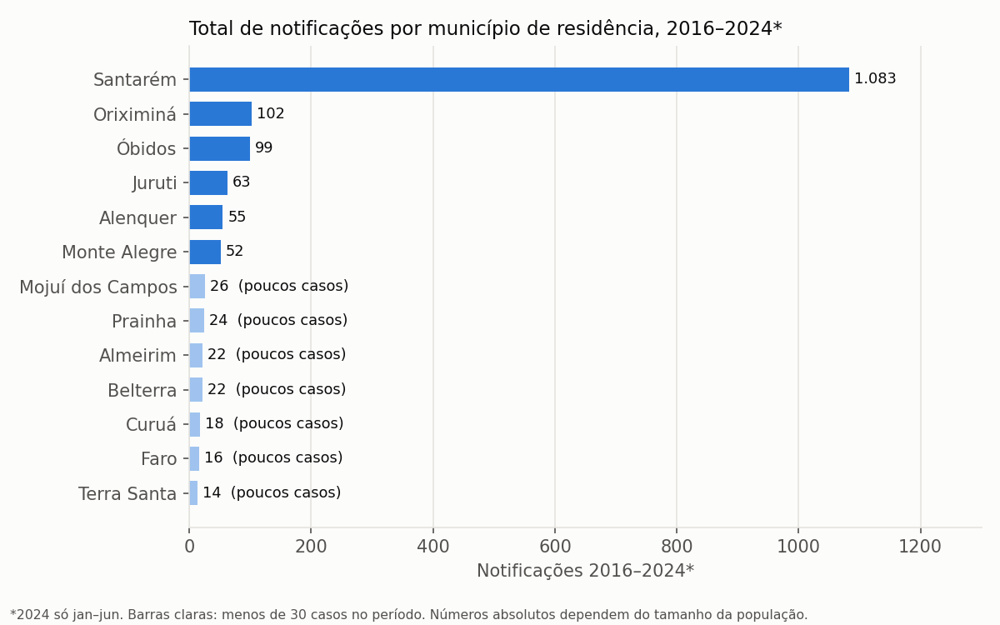
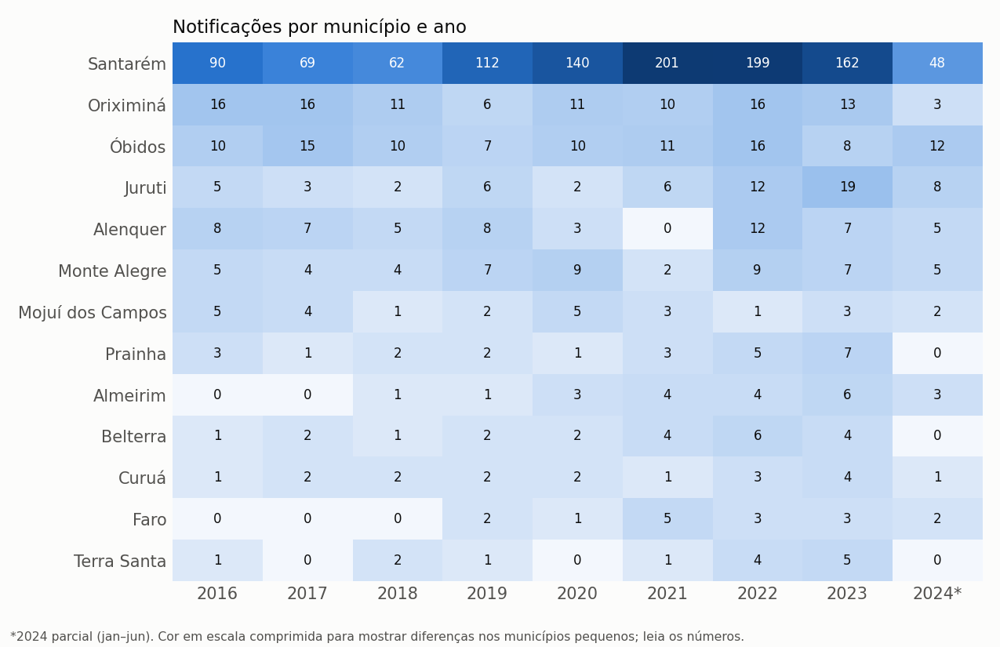
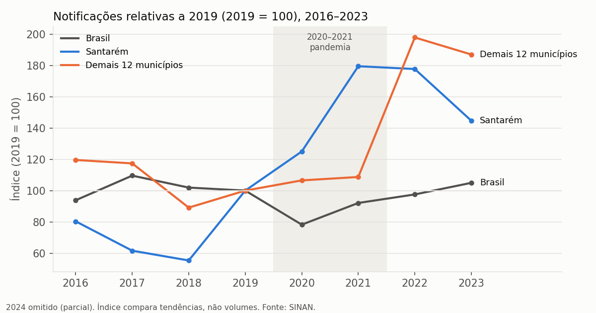

# Séries de notificações de HIV — Baixo Amazonas, 2016–2024

Gerado por `scripts/03_series.py` a partir de `dados/hiv_baixo_amazonas.csv` (1.596 notificações, município de residência, **ano de notificação**). Todos os valores são calculados; sem taxas por habitante (não há população na pasta).

> **Leia com cuidado:** notificação não é incidência. O número depende também de testagem, acesso a serviços e digitação no SINAN. **2024 tem só janeiro a junho** e não é comparável com os anos fechados.

## 1. Região: casos por ano e variação anual

| Ano | Casos | Var. % | Santarém | Var. % Stm | Demais 12 | Var. % demais |
|---|---:|---:|---:|---:|---:|---:|
| 2016 | 145 | — | 90 | — | 55 | — |
| 2017 | 123 | -15,2% | 69 | -23,3% | 54 | -1,8% |
| 2018 | 103 | -16,3% | 62 | -10,1% | 41 | -24,1% |
| 2019 | 158 | +53,4% | 112 | +80,6% | 46 | +12,2% |
| 2020 | 189 | +19,6% | 140 | +25,0% | 49 | +6,5% |
| 2021 | 251 | +32,8% | 201 | +43,6% | 50 | +2,0% |
| 2022 | 290 | +15,5% | 199 | -1,0% | 91 | +82,0% |
| 2023 | 248 | -14,5% | 162 | -18,6% | 86 | -5,5% |
| 2024* | 89 | — | 48 | — | 41 | — |

*2024 parcial: variação não calculada. Total 2016–2024: 1.596.

### Comparação justa para 2024: só o 1º semestre (jan–jun)

| Ano | Casos jan–jun | Var. % | Santarém | Demais 12 |
|---|---:|---:|---:|---:|
| 2016 | 118 | — | 76 | 42 |
| 2017 | 66 | -44,1% | 38 | 28 |
| 2018 | 55 | -16,7% | 32 | 23 |
| 2019 | 47 | -14,5% | 33 | 14 |
| 2020 | 86 | +83,0% | 64 | 22 |
| 2021 | 112 | +30,2% | 83 | 29 |
| 2022 | 143 | +27,7% | 98 | 45 |
| 2023 | 147 | +2,8% | 107 | 40 |
| 2024 | 89 | -39,5% | 48 | 41 |

Atenção: a digitação no SINAN é irregular de mês a mês (ver `decisoes_limpeza.md`) e 2024 pode ainda receber notificações atrasadas; a comparação por semestre também é frágil.

## 2. Municípios em números absolutos

| Município | 2016 | 2017 | 2018 | 2019 | 2020 | 2021 | 2022 | 2023 | 2024* | Total | % do total | Anos com 0 |
|---|---:|---:|---:|---:|---:|---:|---:|---:|---:|---:|---:|---:|
| Alenquer | 8 | 7 | 5 | 8 | 3 | 0 | 12 | 7 | 5 | 55 | 3,4% | 1 |
| Almeirim | 0 | 0 | 1 | 1 | 3 | 4 | 4 | 6 | 3 | 22 | 1,4% | 2 |
| Belterra | 1 | 2 | 1 | 2 | 2 | 4 | 6 | 4 | 0 | 22 | 1,4% | 1 |
| Curuá | 1 | 2 | 2 | 2 | 2 | 1 | 3 | 4 | 1 | 18 | 1,1% | 0 |
| Faro | 0 | 0 | 0 | 2 | 1 | 5 | 3 | 3 | 2 | 16 | 1,0% | 3 |
| Juruti | 5 | 3 | 2 | 6 | 2 | 6 | 12 | 19 | 8 | 63 | 3,9% | 0 |
| Mojuí dos Campos | 5 | 4 | 1 | 2 | 5 | 3 | 1 | 3 | 2 | 26 | 1,6% | 0 |
| Monte Alegre | 5 | 4 | 4 | 7 | 9 | 2 | 9 | 7 | 5 | 52 | 3,3% | 0 |
| Óbidos | 10 | 15 | 10 | 7 | 10 | 11 | 16 | 8 | 12 | 99 | 6,2% | 0 |
| Oriximiná | 16 | 16 | 11 | 6 | 11 | 10 | 16 | 13 | 3 | 102 | 6,4% | 0 |
| Prainha | 3 | 1 | 2 | 2 | 1 | 3 | 5 | 7 | 0 | 24 | 1,5% | 1 |
| Santarém | 90 | 69 | 62 | 112 | 140 | 201 | 199 | 162 | 48 | 1.083 | 67,9% | 0 |
| Terra Santa | 1 | 0 | 2 | 1 | 0 | 1 | 4 | 5 | 0 | 14 | 0,9% | 3 |
| **Total** | **145** | **123** | **103** | **158** | **189** | **251** | **290** | **248** | **89** | **1.596** | **100,0%** | **—** |

## 3. Participação de cada município no total do ano (%)

| Município | 2016 | 2017 | 2018 | 2019 | 2020 | 2021 | 2022 | 2023 | 2024* | 2016–2024 |
|---|---:|---:|---:|---:|---:|---:|---:|---:|---:|---:|
| Alenquer | 5,5% | 5,7% | 4,9% | 5,1% | 1,6% | 0,0% | 4,1% | 2,8% | 5,6% | 3,4% |
| Almeirim | 0,0% | 0,0% | 1,0% | 0,6% | 1,6% | 1,6% | 1,4% | 2,4% | 3,4% | 1,4% |
| Belterra | 0,7% | 1,6% | 1,0% | 1,3% | 1,1% | 1,6% | 2,1% | 1,6% | 0,0% | 1,4% |
| Curuá | 0,7% | 1,6% | 1,9% | 1,3% | 1,1% | 0,4% | 1,0% | 1,6% | 1,1% | 1,1% |
| Faro | 0,0% | 0,0% | 0,0% | 1,3% | 0,5% | 2,0% | 1,0% | 1,2% | 2,2% | 1,0% |
| Juruti | 3,4% | 2,4% | 1,9% | 3,8% | 1,1% | 2,4% | 4,1% | 7,7% | 9,0% | 3,9% |
| Mojuí dos Campos | 3,4% | 3,3% | 1,0% | 1,3% | 2,6% | 1,2% | 0,3% | 1,2% | 2,2% | 1,6% |
| Monte Alegre | 3,4% | 3,3% | 3,9% | 4,4% | 4,8% | 0,8% | 3,1% | 2,8% | 5,6% | 3,3% |
| Óbidos | 6,9% | 12,2% | 9,7% | 4,4% | 5,3% | 4,4% | 5,5% | 3,2% | 13,5% | 6,2% |
| Oriximiná | 11,0% | 13,0% | 10,7% | 3,8% | 5,8% | 4,0% | 5,5% | 5,2% | 3,4% | 6,4% |
| Prainha | 2,1% | 0,8% | 1,9% | 1,3% | 0,5% | 1,2% | 1,7% | 2,8% | 0,0% | 1,5% |
| Santarém | 62,1% | 56,1% | 60,2% | 70,9% | 74,1% | 80,1% | 68,6% | 65,3% | 53,9% | 67,9% |
| Terra Santa | 0,7% | 0,0% | 1,9% | 0,6% | 0,0% | 0,4% | 1,4% | 2,0% | 0,0% | 0,9% |

## 4. Variação % anual por município

Mostrada só quando o ano anterior tem pelo menos 10 casos; abaixo disso, uma diferença de 1 ou 2 casos vira variação de 50% a 200% e não informa nada. 2024 não calculado (parcial).

| Município | 2017 | 2018 | 2019 | 2020 | 2021 | 2022 | 2023 |
|---|---:|---:|---:|---:|---:|---:|---:|
| Alenquer | — | — | — | — | — | — | -41,7% |
| Juruti | — | — | — | — | — | — | +58,3% |
| Óbidos | +50,0% | -33,3% | -30,0% | — | +10,0% | +45,5% | -50,0% |
| Oriximiná | +0,0% | -31,2% | -45,5% | — | -9,1% | +60,0% | -18,8% |
| Santarém | -23,3% | -10,1% | +80,6% | +25,0% | +43,6% | -1,0% | -18,6% |

## 5. Pontos de atenção

**Municípios com poucos casos** (menos de 30 em 2016–2024): Terra Santa (14, 3 ano(s) com zero); Faro (16, 3 ano(s) com zero); Curuá (18, 0 ano(s) com zero); Belterra (22, 1 ano(s) com zero); Almeirim (22, 2 ano(s) com zero); Prainha (24, 1 ano(s) com zero); Mojuí dos Campos (26, 0 ano(s) com zero). Nesses municípios, variações e participações oscilam com 1 ou 2 casos e não devem ser interpretadas como tendência. Zero casos num ano não significa ausência de HIV.

**Concentração em Santarém:** 67,9% das notificações do período (de 60,2% em 2018 a 80,1% em 2021). Isso é esperado pelo tamanho da população e por Santarém concentrar serviços de testagem, mas sem população não dá para dizer se o risco é maior lá.

**2024 parcial:** 89 notificações em seis meses. No 1º semestre, 2023 teve 147 e 2024 teve 89 (-39,5%). Não dá para concluir se é queda real, atraso de digitação ou oscilação.

**2020–2021 (período da pandemia de covid-19):** no Brasil, as notificações foram de 51.053 em 2019 para 39.946 em 2020 (-21,8%) e só superaram o nível de 2019 em 2023. No Baixo Amazonas o movimento foi diferente: 158 em 2019, 189 em 2020 (+19,6%) e 251 em 2021 (+32,8%). O crescimento vem principalmente de Santarém (112 → 140 → 201); os demais 12 municípios somados ficaram estáveis (46 → 49 → 50). Os dados não permitem dizer a causa. Hipóteses a verificar com a gestão: ampliação de testagem rápida ou de serviços em Santarém, busca ativa, mudança na rotina de digitação (a série mensal mostra lotes) ou notificação de casos antigos. Também não dá para afirmar que a pandemia não afetou a região: o diagnóstico pode ter sido represado e aparecido depois.

**Crescimento 2016–2022:** a região passou de 145 (2016) para 290 (2022), com queda em 2023 (248). Aumento de notificação pode refletir mais testagem e melhor vigilância, não necessariamente mais infecções.
